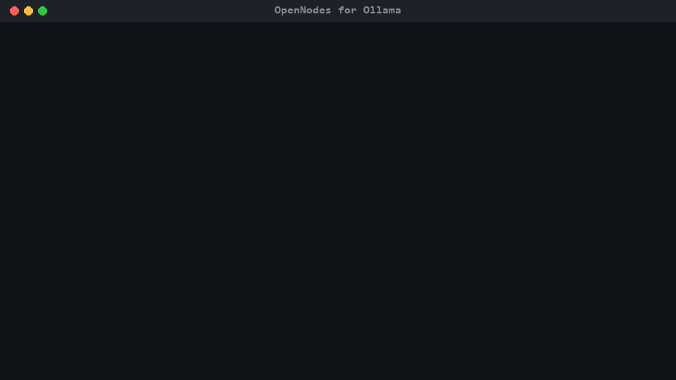
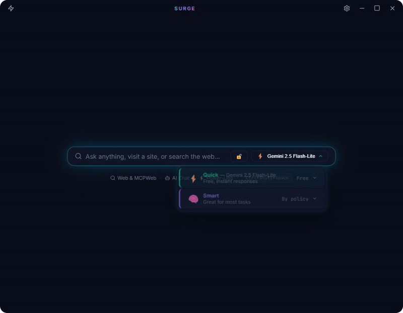

# OpenNodes

[](https://www.npmjs.com/package/@opennodes/cli)
[](https://pypi.org/project/onp-node/)
[](https://glama.ai/mcp/servers/opennodes-io/opennodes)
[](LICENSE)

**AI inference, measured — not just claimed.** OpenNodes is an open protocol (ONP) and registry for AI inference endpoints, from your own Ollama box to sovereign EU clouds. The registry checks what each endpoint really serves — which model, how much context actually works, how fast it answers, on what hardware, at what price — and your prompts go straight to the endpoint you pick: OpenNodes is never in the data path.

- **Browse:** [registry.opennodes.io](https://registry.opennodes.io) — 10,000+ offerings from about 250 providers, with trust tiers and measured results
- **Learn:** [opennodes.io](https://opennodes.io) · [Integrations](https://opennodes.io/integrations) (Cursor, Claude, VS Code, Open WebUI, OpenAI SDKs, agents)
- **Status:** ONP Draft 0.1, a working proposal not affiliated with any standards body yet; reference stack live, with project-run reference nodes in Germany and Finland. Operators: [list your endpoint](node-kit/README.md) or write to operators@opennodes.io.

## Quick start

```bash
npx @opennodes/ollama-router            # OpenNodes for Ollama: one Ollama endpoint over local + LAN + verified public models
npx @opennodes/cli mcp --print-config   # MCP tools for Cursor / VS Code / Claude Desktop (or use https://registry.opennodes.io/mcp)
npx @opennodes/cli gateway --port 4141  # OpenAI-compatible gateway with onp/auto routing; base URL http://127.0.0.1:4141/v1
npx @opennodes/registry                 # run your own registry: web app + API + MCP on http://127.0.0.1:4300
pipx install onp-node                   # Node Kit: list a vLLM / Ollama / TGI deployment, or an API you already run
```

npm: [@opennodes/core](https://www.npmjs.com/package/@opennodes/core) · [@opennodes/cli](https://www.npmjs.com/package/@opennodes/cli) · [@opennodes/registry](https://www.npmjs.com/package/@opennodes/registry) · [@opennodes/ollama-router](https://www.npmjs.com/package/@opennodes/ollama-router) — PyPI: [onp-node](https://pypi.org/project/onp-node/)



**OpenNodes for Ollama** ([impl/packages/ollama-router](impl/packages/ollama-router/README.md)): point Open WebUI, Continue, Zed, or the `ollama` CLI at `OLLAMA_HOST=127.0.0.1:11435` and one model list spans your local Ollama, other machines on your LAN (plain Ollama servers or Node Kit nodes, auto-discovered via mDNS), and verified public nodes from the registry — with `auto`, `auto-cheap`, `auto-fast`, `auto-quality`, `auto-private` (never leaves the LAN), `auto-eu` and `auto-ca` or any `auto-<country>` (LAN plus operators in that jurisdiction) routed by the advisor, pinned prices, budget caps, and signed receipts for public calls.

**MCP server** — five read-only tools: `recommend` (best node and model for a task; the prompt is analysed locally and only its features are sent), `search_offerings`, `get_offering`, `get_node`, `estimate`. Listed on the [MCP Registry](https://registry.modelcontextprotocol.io/v0/servers?search=io.github.opennodes-io/opennodes) (as `io.github.opennodes-io/opennodes`, stdio and remote), [Glama](https://glama.ai/mcp/servers/opennodes-io/opennodes) and mcprush:

[](https://mcprush.com/to/opennodes-mcp?ref=badge)

## Why a protocol

MCP standardized how AI applications reach *tools*; the OpenAI API shape standardized how they *invoke models* — but **nothing standardizes how a client finds an inference endpoint it doesn't already know about**: what model it serves, how big it is, what hardware backs it, how well it benchmarks, what it costs per token, and whether it's up. ONP fills exactly that gap and composes the rest from existing standards: a signed Node Card at `/.well-known/open-node.json`, a registry API with automated verification, OpenAI-compatible invocation with pinned prices, and signed usage receipts.

## Documents

### Start here
- [00 — Project overview](docs/00-project-overview.md) — the concept, architecture, implementation status, completed development stages, and next steps in one document.

### Research (why this standard, and why now)
- [01 — Protocol & standards landscape](docs/01-protocol-landscape.md) — MCP + Registry, WebMCP, A2A, AGNTCY, ANP, NANDA, OpenAI-compatible APIs, DIDs/VCs, x402, UCAN, model cards, MLPerf; full gap analysis.
- [02 — Market landscape & demand evidence](docs/02-market-landscape.md) — OpenRouter, HF Inference Providers, gateways, DePIN/decentralized compute, OS-level AI runtimes, payment rails; viability assessment.
- [05 — OpenNodes and European digital sovereignty](docs/05-eu-sovereignty-brief.md) — one-page brief: no middlebox, EU/EEA jurisdiction filter, signed self-descriptions and receipts, mapped to GDPR, the AI Act and the Data Act ([web version](https://opennodes.io/eu)).
- [04 — Universal AI client landscape](docs/04-universal-client-landscape.md) — AI browsers, branded assistants, neutral/BYOK clients, multi-homing data, distribution economics; assessment of the "primary access point" client idea.

### Specification suite
- [ONP-1 — Overview, terminology, architecture, conformance](spec/ONP-1-overview.md)
- [ONP-2 — The Node Card](spec/ONP-2-node-card.md) — self-description document at `/.well-known/open-node.json`
- [ONP-3 — Registry & Discovery API](spec/ONP-3-registry.md) — registration, verification, search, health, ranking, federation
- [ONP-4 — Invocation profiles](spec/ONP-4-invocation.md) — bindings for text, image/diffusion, embeddings, agents
- [ONP-5 — Settlement](spec/ONP-5-settlement.md) — price advertisement, payment schemes (x402 / prepaid / free), signed usage receipts
- [ONP-6 — Bridging](spec/ONP-6-bridging.md) — connecting discovered nodes to MCP servers, WebMCP sites, and conventional web data

### Development requirements
- [REQ-001 — Discovery Service (registry)](requirements/REQ-001-discovery-service.md) — MVP registry: registration, admission battery, search, estimation, MCP surface; acceptance criteria.
- [REQ-002 — Test client](requirements/REQ-002-test-client.md) — CLI + OpenAI-compatible gateway + MCP modes; compatibility matrix (Cursor, VS Code, Open WebUI…).
- [REQ-003 — Node Kit](requirements/REQ-003-node-kit.md) — reverse-proxy wrapper turning vLLM/Ollama/TGI into a conforming node: card generation, receipts, registration, self-test.

### Implementation
- [schemas/open-node.schema.json](schemas/open-node.schema.json) — normative JSON Schema for the Node Card (Phase 0 deliverable).
- [impl/](impl/README.md) — reference stack source (registry + fixture node + `onp` CLI/gateway); `npm install && npm test` in `impl/`.
- [node-kit/](node-kit/README.md) — Python Node Kit (REQ-003): wraps any OpenAI-compatible engine (vLLM/Ollama/TGI) into a conforming node; cross-language e2e against the JS registry.

## Ecosystem

Clients and products consuming ONP — independent of the standard, listed here for discovery:

- **[Surge](https://github.com/opennodes-io/surge)** (desktop client, pre-release — [Windows installer](https://github.com/opennodes-io/surge/releases); macOS and Linux build from source) — a desktop "browser for MCP" and the reference OpenNodes client: the model picker is fed live from the registry (trust tier, measured latency, price), **Auto** runs the advisor on your machine to pick a node per prompt, and every call is pinned to the node's card revision and comes back with a signed receipt Surge verifies. A spend policy is on from first launch, a dashboard keeps the ledger, and one click switches to private mode (local Ollama and LAN only). The first client to span both discovery layers (models via ONP, tools via MCP).

  

- **Your client here** — ONP is an open standard; any client can implement discovery via [ONP-3](spec/ONP-3-registry.md) and invocation via [ONP-4](spec/ONP-4-invocation.md). Open a PR to be listed.

## Design principles

1. **Standardize the gap, reuse the rest.** ONP defines only the Node Card, the Registry API, and thin profiles binding existing standards together. Invocation is OpenAI-compatible; payment is x402/prepaid; identity is domain-based with optional DIDs; tool access is MCP.
2. **Registry as a protocol, not a place.** Like the MCP Registry, ONP specifies an OpenAPI interface any registry can implement. Anyone can run a registry; clients can query several; a root "meta-registry" is a bootstrap convenience, not an architectural requirement.
3. **Metadata is claims + attestations.** Nodes self-report; registries and third-party attesters verify (liveness probes, conformance tests, benchmark attestations as Verifiable Credentials). Rank is computed by registries from declared, transparent components — ONP standardizes the *signal format*, not the ranking formula.
4. **Curated trust tiers, permissionless entry.** Anyone can publish a Node Card and register (Community tier). Paid production traffic concentrates in Verified/Attested tiers — this is the lesson of Bittensor/Akash vs. OpenRouter/HF.
5. **The client is the orchestrator.** Multi-node scenarios, MCP bridging, and WebMCP access are client-side composition over standard primitives — ONP specifies the primitives and a portable scenario format, not an orchestration runtime.
